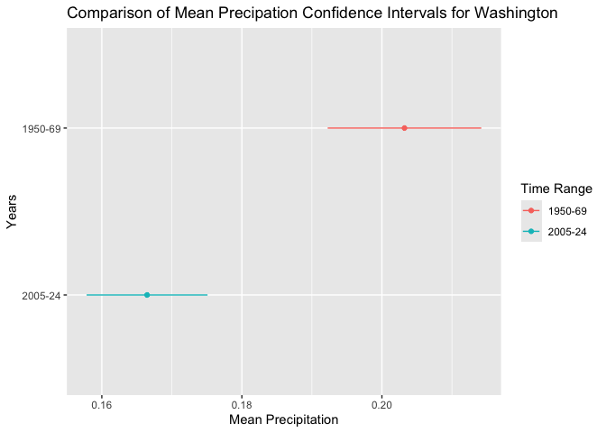
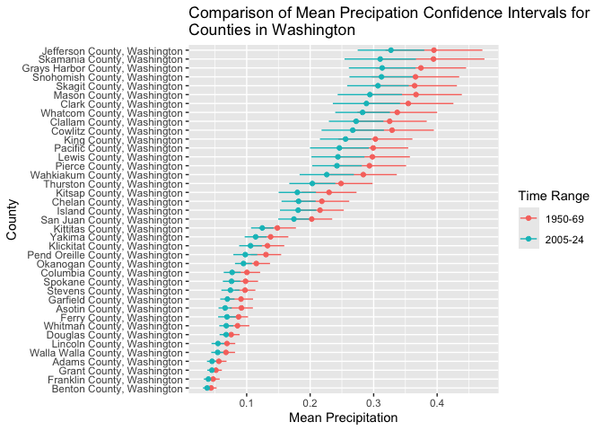
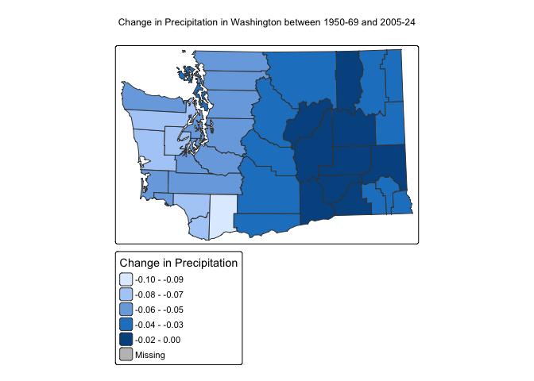

Geog 4/6300: Lab 3-Confidence intervals
================

## Confidence intervals

**Your name: Alina Hashmi**

**Overview:**

In this lab, we will create confidence intervals for January
precipitation in Washington during two time periods: 1950-1969 and
2005-2024. Using county-level precipitation data from the ERA5 dataset,
you will estimate statewide precipitation patterns, then examine
variation and change at the county level. We’ve summed the precipitation
in January for each county over two twenty year time periods: 1950-1969
and 2005-2024. You’ll be using those data to create confidence intervals
at a state and county level.

To load these data, load the csv file, which is included in the data
folder:

``` r
era5_data<-read_csv("data/precip_uswest_era5.csv")
```

This is a long format dataset including county identifiers, county
population, median household income, and poverty rate. Census figures
are based on the 2018-22 ACS. The last two columns (year, prcp_m,
time_range) give the year and total precipitation in meters from the
ERA5 NetCDF file, and two time ranges (1950-1969 and 2005-2024).

The script used to create this dataframe is also provided in this
repository (‘lab3_dataprep’), along with rasters of the yearly mean
total precipitation for Januaries in the two time periods of interest.

For this lab to be marked complete, it must demonstrate the following
learning standards:

- 11. Create effective data visualizations across multiple chart types
      (line, scatter, histogram, Q-Q plot), applying appropriate
      aesthetic choices such as color, grouping, and labeling. (Tasks 2
      and 5)
- 12. Produce and interpret confidence interval plots that enable visual
      comparison of means and uncertainty across groups or time periods.
      (Tasks 2, 3, 5, and 6)
- 13. Visualize spatial data using appropriate mapping tools, selecting
      suitable classification schemes and cartographic elements to
      support clear communication. (Task 7)
- 14. Arrange and present tabular results in a readable format
      appropriate for a technical document or report. (Tasks 1 and 4)
- 15. Use measures of central tendency and dispersion to describe the
      variables in tabular datasets (Tasks 1 and 4)
- 20. Explaining how evidence from a sample supports conclusions about a
      population while acknowledging sampling variability and
      uncertainty. (Tasks 3 and 6)
- 22. Construct and interpret confidence intervals, explaining how
      factors such as sample size and spatial scale affect the precision
      of an estimate. (Tasks 1, 3, 4 and 6)

# Part 1: Calculating statewide confidence intervals for Washington’s precipitation

In the first part of this lab, you’ll determine a confidence interval
for Washington’s precipitation for these two time periods. This can be
helpful in identifying whether precipitation has changed across the
state (e.g., whether the two confidence intervals overlap) using the
county data as your sample.

**Task 1** *Load the data and filter it to just include data for the
state of Washington. Then create a table showing mean precipitation,
standard deviation, number of observations (sample size), and
upper/lower confidence interval bounds for each of the two time periods
in the `time_range` field. Use `kable` to display the table when you are
done.*

``` r
washington1950 <- era5_data %>%
  filter(st_name == "Washington", time_range == "1950-69")

washington2005 <- era5_data %>%
  filter(st_name == "Washington", time_range == "2005-24")

washington_stats <- washington1950 %>%
  summarize(mean_precip = mean(prcp_m), sd_precip = sd(prcp_m), n = n()) %>%
  mutate(time_range = "1950-69") %>%
  bind_rows(
    washington2005 %>%
  summarize(mean_precip = mean(prcp_m), sd_precip = sd(prcp_m), n = n()) %>%
  mutate(time_range = "2005-24")
  )

washington_stats <- washington_stats %>%
  mutate(lower_CI = mean_precip - ((sd_precip/sqrt(n)) * qnorm(0.975))) %>%
  mutate(upper_CI = mean_precip + ((sd_precip/sqrt(n)) * qnorm(0.975)))

washington_stats <- washington_stats %>% relocate(time_range)

kable(head(washington_stats))
```

| time_range | mean_precip | sd_precip |   n |  lower_CI |  upper_CI |
|:-----------|------------:|----------:|----:|----------:|----------:|
| 1950-69    |   0.2032239 | 0.1562948 | 780 | 0.1922554 | 0.2141923 |
| 2005-24    |   0.1664626 | 0.1230138 | 780 | 0.1578298 | 0.1750955 |

Using the code provided in class, create a ggplot graphic that
visualizes these two confidence intervals. You’ll want to use
`geom_point` and `geom_linerange` to do so. Use states as the y-axis and
mean precipitation as the x axis. Vary the color and position of the
dots and lines for the mean/CI by the `time_range` variable. Feel free
to also experiment with axis labels/themes to make the graph more
appealing and accessible.

**Task 2** *Create a ggplot graphic as described above to show the
confidence intervals for precipitation in Washington for each time
range.*

``` r
washington_stats <- washington_stats %>%
  mutate(state = "Washington")

ggplot(washington_stats, aes(y = reorder(time_range, mean_precip), color = time_range)) +
  geom_linerange(
    aes(xmin = lower_CI, xmax = upper_CI)
  ) +
  geom_point(
    aes(x = mean_precip)
  ) +
  labs(
    title = "Comparison of Mean Precipation Confidence Intervals for Washington",
    x = "Mean Precipitation",
    y= "Years",
    color = "Time Range"
  )
```

<!-- -->

**Task 3** *Interpret your table and graph. What do they tell us about
the change in Washington’s precipitation during this time?*

In the time interval 1950-69, the state of Washington had an average of
0.203 meters of precipitation for the sample data set. Based on the
confidence intervals, we are 95% confident that the true mean for the
entire state of Washington falls between 0.192 meters and 0.214 meters
of precipitation, given by the lower and upper confidence intervals
found. On the other hand, the 2005-24 observations had an average of
0.166 meters of precipitation for the sample data set. Based on the
confidence interval found, we are 95% confident that the true mean for
the entire state of Washington falls between 0.158 and 0.175 meters of
precipitation. The 1950-1969 observations had a standard deviation of
0.156 while the 2005-24 observations had a standard deviation of 0.123.
This let’s us know that the data for the 1950-69 observations was more
varied since the two data sets had the same sample size. Additionally,
Washington experienced greater precipitation in the years between 1950
and 1969 compared to 2005-24 as the upper interval for the 2005-24
sample does not overlap with the lower interval for the 1950-69 sample.

# Part 2: Analyzing county data in Washington.

In part 1, you ran a state level analysis. What if you wanted to
identify where populations might be negatively affected by precipitation
changes within a state? In this section, you’ll look at the changes in
precipitation **at county level** in Washington to

To start with, adapt your code from step 1 so that you create confidence
intervals for **counties** instead of states. After creating that
dataset, create another ggplot graph of those confidence intervals that
you can compare to the state level data in Task 2 to examine how
precipitation has changed across counties in Washington.

**Task 4** *Create a summary table for January precipitation in
Washington counties for both time periods. Use the same approach as in
Task 1, but calculate statistics for counties rather than the state as a
whole. Call the head of your table with `kable` when you are done.*

``` r
washington_county <- washington1950 %>%
  group_by(cty_name) %>%
  summarize(mean_precip = mean(prcp_m), sd_precip = sd(prcp_m), n = n()) %>%
  mutate(time_range = "1950-69") %>%
  bind_rows(
    washington2005 %>%
      group_by(cty_name) %>%
  summarize(mean_precip = mean(prcp_m), sd_precip = sd(prcp_m), n = n()) %>%
  mutate(time_range = "2005-24")
  )

washington_county <- washington_county %>%
  mutate(lower_CI = mean_precip - ((sd_precip/sqrt(n)) * qnorm(0.975))) %>%
  mutate(upper_CI = mean_precip + ((sd_precip/sqrt(n)) * qnorm(0.975)))

kable(head(washington_county))
```

| cty_name | mean_precip | sd_precip | n | time_range | lower_CI | upper_CI |
|:---|---:|---:|---:|:---|---:|---:|
| Adams County, Washington | 0.0561916 | 0.0275746 | 20 | 1950-69 | 0.0441067 | 0.0682765 |
| Asotin County, Washington | 0.0917109 | 0.0412774 | 20 | 1950-69 | 0.0736206 | 0.1098012 |
| Benton County, Washington | 0.0439175 | 0.0199657 | 20 | 1950-69 | 0.0351673 | 0.0526677 |
| Chelan County, Washington | 0.2184237 | 0.0983827 | 20 | 1950-69 | 0.1753063 | 0.2615410 |
| Clallam County, Washington | 0.3252100 | 0.1331571 | 20 | 1950-69 | 0.2668524 | 0.3835676 |
| Clark County, Washington | 0.3545254 | 0.1621728 | 20 | 1950-69 | 0.2834514 | 0.4255995 |

**Task 5** *Visualize the confidence intervals for the county-level data
you generated in task 4, using the same style as you did for Task 2
above. For an optional extra challenge, visually highlight the counties
where the confidence intervals between time periods do NOT overlap.*

``` r
ggplot(washington_county, aes(y = reorder(cty_name, mean_precip), color = time_range)) +
  geom_linerange(aes(xmin = lower_CI, xmax = upper_CI)) +
  geom_point(aes(x = mean_precip)) +
  labs(
    title = "Comparison of Mean Precipation Confidence Intervals for \nCounties in Washington",
    x = "Mean Precipitation",
    y= "County",
    color = "Time Range"
  )
```

<!-- -->

**Task 6**: *Compare the size of the error terms for your county level
data to the error terms at state level that you calculated in Task 1.
Are they bigger or smaller? Explain why the formula you used for
calculating the error terms produced error terms of different sizes. How
is this difference visible in your ggplot graphs?*

Counties in Washington that experienced a higher sample mean had a
larger confidence interval compared to the counties that had a smaller
sample mean. This could be due to the data being more varied since each
county had the same sample size. Compared to the state’s summary
statistics, the county data still had a greater interval with the
smallest interval having a mean of 0.0377 and a lower confidence
interval of 0.0311 and upper confidence interval of 0.0445. This could
also be attributed to the sample size as each county had 20 observations
while the state had 780 observations. The formula for standard error
divides the standard deviation by the sample size, so the standard error
can either be affected by variation in the data or the size of the data.
Since the counties shared the same sample size, the difference in the
margin of errors between the counties is more likely due to some
counties having more variation in their data. On the other hand, since
the difference in the sample size was so drastic between the counties
and state data, the difference in the margin of error is more likely due
to the sample size. The difference can be seen on the graph by the long
horizontal lines that stretch out from the point. While the lines in the
state graph are somewhat long, the interval for the x-axis is much
smaller on the state level graph than the x-axis on the counties graph.

**Task 7**: *Transform the county data from task 4 into wide format so
that the means for each time period are in the same row for each county.
Then calculate the change in precipitation between the time periods.
Join this table to the geopackage file that contains county boundaries
and census data, making sure that you only have Washington counties
included - use the geopackage `data/acsdata_cty_westreg.gpkg`. Then use
`tmap` to map out the difference in precipitation means across the two
time periods. Make sure the legend of this map is interpretable.*

``` r
washington_county_wide <- washington_county %>%
  pivot_wider(
    names_from = time_range,
    values_from = c(mean_precip, sd_precip, lower_CI, upper_CI)
  ) 

washington_county_wide <- washington_county_wide %>%
  mutate(change_in_precip = `mean_precip_2005-24` - `mean_precip_1950-69`)

washington_spatial <- st_read("data/acsdata_cty_westreg.gpkg") %>% 
  st_transform(2286) %>%
  filter(st_name == "Washington")
```

    ## Reading layer `acsdata_cty_westreg' from data source 
    ##   `/Users/alinahashmi/Documents/GitHub/geog4300_lab3/data/acsdata_cty_westreg.gpkg' 
    ##   using driver `GPKG'
    ## Simple feature collection with 414 features and 8 fields
    ## Geometry type: MULTIPOLYGON
    ## Dimension:     XY
    ## Bounding box:  xmin: -124.7322 ymin: 31.33223 xmax: -102.0416 ymax: 49.00237
    ## Geodetic CRS:  WGS 84

``` r
washington_spatial_join <- left_join(washington_spatial, washington_county_wide, by = "cty_name")

tm_shape(washington_spatial_join) +
  tm_polygons(
    fill = "change_in_precip",
    fill.scale = tm_scale_intervals(style = "jenks"),
    title = "Change in Precipitation"
  ) + 
  tm_layout(
    main.title = "Change in Precipitation in Washington between 1950-69 and 2005-24"
  )
```

    ## 

    ## ── tmap v3 code detected ───────────────────────────────────────────────────────

    ## [v3->v4] `tm_polygons()`: migrate the argument(s) related to the legend of the
    ## map variable `fill` namely 'title' to 'fill.legend = tm_legend(<HERE>)'
    ## [v3->v4] `tm_layout()`: use `tm_title()` instead of `tm_layout(main.title = )`
    ## [plot mode] fit legend/component: Some legend items or map compoments do not
    ## fit well, and are therefore rescaled.
    ## ℹ Set the tmap option `component.autoscale = FALSE` to disable rescaling.

<!-- -->

# Optional challenge section: Interpreting the implications of precipitation changes

Now that you’ve calculated these means and confidence intervals, let’s
identify who might be most affected by changes in precipitation. To see
who is affected, create a dummy variable that flags any counties with a
decline of 5 centimeters or more (0.05 meters) with a 1, labeling all
other counties with a 0. Use group_by and summarise to do the following:

- Count the total population in each of these two county groups.
- Calculate the mean value for median income and poverty rate in these
  two groups.

**Task 8** *Create a dummy variable for counties with a change of 0.05
meters or more between the time periods. Calculate how many people
currently live in these counties along with the mean value of median
income (medinc) and poverty rate (pov_pop_pct) for those areas.*

``` r
washington_affected <- washington_spatial_join %>%
  st_drop_geometry() %>%
  mutate(flag = if_else(change_in_precip <= -0.05, 1, 0))

washington_affected_1 <- washington_affected %>%
  group_by(flag) %>%
  summarize(tot_pop = sum(totpop_race), mean_income = mean(medinc), mean_pov = mean(pov_pop_pct))
```

**Task 9** *Create a one paragraph summary of your results from tasks 7
and 8. What do you learn about how precipitation has changed in the last
70 years across the state of Washington? How would you describe the
population affected by large drops in precipitation based on your
results?*

Over the last 70 years, precipitation has changed unevenly in the state
of Washington. The areas with the most change are the western side of
Washington along the shores while the eastern side of Washington has
remained relatively the same. About a million less people in Washington
are affected by large drops in precipitation (3,368,173) than those who
are not affected (4,320,376 people). Additionally, areas that have
received the greatest change in precipitation do not affect socially
vulnerable areas. The median income for those affected is \$76,272 with
a mean poverty rate of 11.3% and \$70,041 for those not affected with a
mean poverty rate of 13%. This is around the national average.

Small multiples or multi-panel maps are often a helpful way to show
change over time. See this page for more information about how these are
created in `tmap`:

- <https://r-tmap.github.io/tmap/articles/basics_facets>

Using these tools, create a small multiples map of your precipitation
data for counties in a state of your choice for all 40 years in these
two time periods. This means you will have one figure with 40 individual
maps, all of the same state in different years. These maps should allow
easy comparison across years and should be clearly labeled so that they
could be interpreted by someone with no knowledge of this assignment.

In addition, describe two interesting trends you see in the figure you
created.

``` r
washington_40 <- bind_rows(washington1950, washington2005)

washington_40_spatial <- washington_spatial %>%
  left_join(washington_40, by = "cty_name")

washington_40_map <- tm_shape(washington_40_spatial) +
  tm_polygons(fill = "prcp_m", fill.free = FALSE, title = "Precipitation in Meters") +
  tm_facets_wrap(by = "year", ncols = 8) +
  tm_layout(asp = 0, main.title = "Precipitation in Washington Over 40 Years")
```

    ## 

    ## ── tmap v3 code detected ───────────────────────────────────────────────────────

    ## [v3->v4] `tm_polygons()`: migrate the argument(s) related to the legend of the
    ## map variable `fill` namely 'title' to 'fill.legend = tm_legend(<HERE>)'
    ## [v3->v4] `tm_layout()`: use `tm_title()` instead of `tm_layout(main.title = )`

``` r
tmap_save(washington_40_map, filename = "washington_40year_trends.pdf", width = 16, height = 10, units = "in")
```

    ## Map saved to /Users/alinahashmi/Documents/GitHub/geog4300_lab3/washington_40year_trends.pdf
    ## Size: 16 by 10 inches

One interesting trend that I noticed was that eastern side of Washington
has had significantly lower amounts of precipitation compared to the
western part of Washington. The eastern side continuously averaged about
0.0 meters to 0.1 meters of precipitation every year. Another trend that
I noticed was that the precipitation on the western side of Washington
has been on a steady decline over the past 40 years. Apart from 2006 and
2020, the average precipitation in this area has gone from around 0.4
meters to about 0.2 meters.

# Final submission stuff

**Disclosure of assistance:** Besides class materials, what other
sources of assistance did you use while completing this lab? These can
include input from classmates, relevant material identified through web
searches (e.g., Stack Overflow), or assistance from ChatGPT or other AI
tools. How did these sources support your own learning in completing
this lab?

I used Google’s AI overview to assist me in using bind_rows() to join
two tables together. I also used it to help explain the multi-panel maps
tool particularly in regards to laying out the maps in a readable way.
Additionally, I used the AI overview to understand how to create a wide
format table when more than one column is reliant on the pivot column.

**Lab reflection:** How do you feel about the work you did on this lab?
Was it easy, moderate, or hard? What are the biggest things you learned
by completing it?

I feel good about the work I did on this lab. I found it a bit more
challenging than the previous labs. I learned new ways to organize and
create tables and became more comfortable working with spatial data.
Additionally, I learned how to create a multi-panel map as well as a
line range plot.
